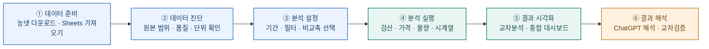

# Nongnet Price Analysis

Google Apps Script와 Google Sheets를 활용해 농넷에서 내려받은 농산물 거래 데이터를 진단·분석하고,  
가격과 거래물량을 비교할 수 있는 분석 시트 및 대시보드를 생성하는 데이터 분석 자동화 프로젝트입니다.

## Project Overview

농산물 가격은 품목·품종·등급·거래단위·도매시장·산지·거래 시점에 따라 달라집니다.

단순 평균가격이나 특정 날짜의 거래가격만으로는 거래조건의 차이를 충분히 설명하기 어렵습니다.  
이에 농넷 원본 데이터의 구조와 단위를 먼저 점검하고, 분석 조건을 설정한 뒤 가격·물량·거래 흐름을 단계적으로 확인할 수 있는 Workflow를 설계했습니다.

이 프로젝트는 농넷 데이터를 자동으로 수집하는 크롤러가 아닙니다.  
사용자가 내려받은 원본 데이터를 Google Sheets로 가져와 분석하는 도구입니다.

## Workflow

## Input Data

농넷에서 다운로드한 거래 데이터의 주요 필수 컬럼은 다음과 같습니다.

- `DATE`
- `거래단위`
- `평균가격`
- `총거래물량`
- `총거래금액`
- `도매시장`
- `품목`
- `품종`
- `산지-광역시도`
- `산지-시군구`
- `등급`

원본 시트 이름을 `RAW`로 변경할 필요는 없습니다.  
필수 컬럼을 기준으로 원본 시트를 탐색하며, 원본 후보가 여러 개라면 분석할 원본을 구분해야 합니다.

## Analysis

원본 데이터와 사용자가 설정한 분석 조건을 기반으로 다음 내용을 확인합니다.

- 원본 관측 기간·행 수·품목 분포
- 결측·해석 불가 값 및 거래단위 진단
- 분석 기간과 품목·품종·등급·시장·산지별 필터
- 분석 대상·조건 제외 데이터 분리 및 합계 검산
- 산지·시장·규격·등급·품종별 거래물량 비교
- kg당 물량가중 가격 및 일별 시계열
- 전년 동일 월일 관측 자료 비교(해당 자료가 있을 때)
- 심층 분석축과 비교축을 활용한 교차분석
- 동일 조건 가격 비교 및 산지–시장 거래 흐름

가격의 단위와 의미가 확인되지 않은 경우 임의로 확정하지 않으며, 서로 다른 규격·등급·품종이 섞인 가격 비교에는 해석상 주의가 필요합니다.

## Dashboard

Google Sheets에서 분석 결과를 단계별 시트와 종합 대시보드로 확인할 수 있도록 구성했습니다.

주요 결과물은 다음과 같습니다.

- `AT_01_범위` — 원본 데이터 범위 확인
- `AT_02_진단` — 데이터 품질 및 단위 점검
- `AT_설정` — 분석 조건 설정
- `AT_04_분석데이터` — 분석 대상 데이터
- `AT_05_개요` 및 관련 시트 — 가격·물량·시계열 분석
- `AT_06_교차` — 분석축 간 교차분석
- `AT_06_동일조건가격` — 비교조건을 통제한 가격표
- `AT_06_산지시장흐름` — 산지–시장 거래 흐름
- `AT_07_종합대시보드` — 주요 결과 시각화

<!-- 실제 대시보드 이미지를 공개 저장소의 docs/dashboard.png에 추가한 후 아래 줄의 주석을 해제하세요.

-->

## Tech Stack

- Google Apps Script
- Google Sheets
- JavaScript
- Nongnet export data
- ChatGPT (분석 결과 해석 및 교차검증 단계)

## Use Case

산지조직 실무자가 농넷 거래 데이터를 바탕으로 시장별 가격과 거래물량, 산지별 거래 흐름, 시점별 변화를 검토하는 업무에 활용할 수 있습니다.

단일 평균가격을 그대로 판매가격으로 적용하기보다, 거래단위·품종·등급·기간 등 비교조건을 확인하고 온라인 시장 데이터 등 다른 자료와 함께 검토하는 가격 의사결정 지원 Workflow를 목표로 합니다.

## Source Code

본 Repository는 프로젝트의 구조와 구현 결과를 소개하기 위한 Portfolio Repository입니다.

개발·운영용 Source Code는 이 공개 저장소에 게시하지 않습니다.
© 2026 baseorigin. All rights reserved.
