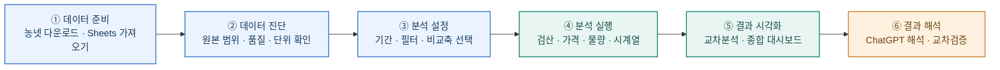
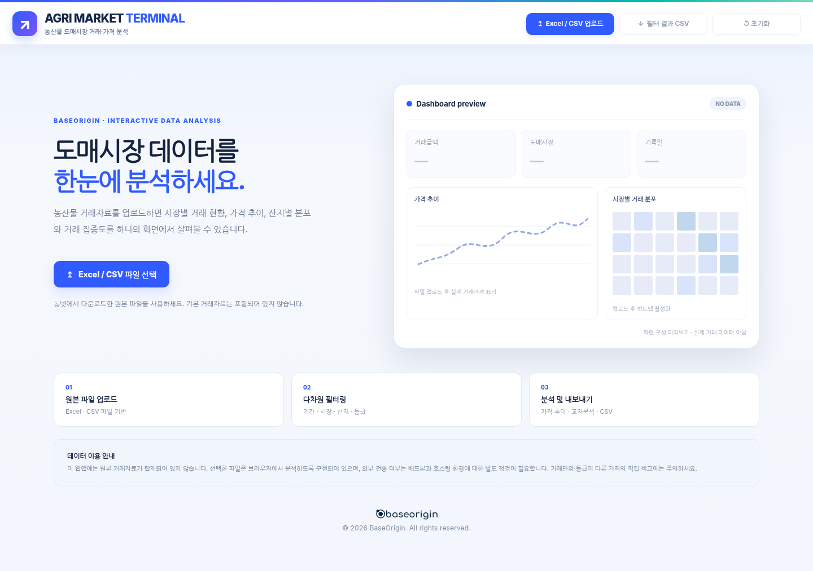

# Nongnet Price Analysis

**Agricultural Wholesale Market Data Analysis & Visualization**

농넷(Nongnet)에서 다운로드한 농산물 거래 데이터를 진단·분석하고, 가격과 거래물량, 도매시장 및 산지별 거래 흐름을 시각화하는 프로젝트입니다.

본 프로젝트에서는 **두 가지 독립적인 분석 도구**를 개발했습니다. 두 도구는 농넷 거래자료를 활용하지만 분석 환경과 구현 방식이 서로 다릅니다.

### 01 · Data Analysis Workflow

**Google Apps Script · Google Sheets | 데이터 분석 자동화**

원본 데이터 진단, 분석 조건 설정, 가격·물량 집계, 교차분석, 검산 및 Google Sheets 종합 대시보드 생성에 초점을 둔 시스템입니다. 개발·운영용 GAS 소스코드는 비공개로 관리합니다.

### 02 · Agri Market Terminal

**HTML · CSS · JavaScript | 인터랙티브 웹 대시보드**

사용자가 농넷 Excel·CSV 거래자료를 업로드해 시장별 거래 현황, 기간별 변화, 산지별 분포와 교차 비교 결과를 탐색할 수 있는 교육용 웹앱입니다. 웹앱의 실행 코드는 이 저장소에 공개되어 있습니다.

---

## Project Overview

농산물 가격은 품목·품종·등급·거래단위·도매시장·산지·거래 시점에 따라 달라집니다.

단순 평균가격이나 특정 날짜의 거래가격만으로는 거래조건의 차이를 충분히 설명하기 어렵습니다. 이에 농넷 원본 데이터의 구조와 단위를 먼저 점검하고, 분석 조건을 설정한 뒤 가격·물량·거래 흐름을 단계적으로 확인할 수 있는 워크플로우를 설계했습니다.

본 프로젝트는 농넷 데이터를 자동으로 수집하는 크롤러가 아닙니다. 사용자가 농넷에서 직접 내려받은 거래자료를 분석합니다.

---

## 01. Data Analysis Workflow

**Google Apps Script + Google Sheets**

농넷 거래자료를 Google Sheets로 가져와 원본 진단부터 분석 및 결과 검증까지 단계적으로 수행합니다.

### Analysis Workflow

### Input Data

농넷에서 내려받은 거래 데이터의 주요 필수 컬럼은 다음과 같습니다.

- `DATE`
- `거래단위`
- `평균가격`
- `총거래물량`
- `총거래금액`
- `도매시장`
- `품목`
- `품종`
- `산지-광역시도`
- `산지-시군구`
- `등급`

원본 시트 이름을 `RAW`로 변경할 필요는 없습니다. 필수 컬럼을 기준으로 원본 시트를 탐색하며, 원본 후보가 여러 개라면 분석할 원본을 구분해야 합니다.

### Analysis

**데이터 진단·검증**

- 원본 관측 기간·행 수·품목 분포
- 결측·해석 불가 값 및 거래단위 진단
- 분석 대상·조건 제외 데이터 분리 및 합계 검산

**거래·가격 분석**

- 분석 기간과 품목·품종·등급·시장·산지별 필터
- 산지·시장·규격·등급·품종별 거래물량 비교
- kg당 물량가중 가격 및 일별 시계열
- 전년 동일 월일 관측 자료 비교(해당 자료가 있을 때)

**교차분석·결과 해석**

- 심층 분석축과 비교축을 활용한 교차분석
- 동일 조건 가격 비교 및 산지–시장 거래 흐름
- ChatGPT를 활용한 결과 해석 및 원본 자료 교차검증

가격의 단위와 의미가 확인되지 않은 경우 임의로 확정하지 않으며, 서로 다른 규격·등급·품종이 섞인 가격 비교에는 주의가 필요합니다.

### Google Sheets Dashboard

분석 결과를 단계별 시트와 종합 대시보드에서 확인할 수 있도록 구성했습니다.

- `AT_01_범위` — 원본 데이터 범위 확인
- `AT_02_진단` — 데이터 품질 및 단위 점검
- `AT_설정` — 분석 조건 설정
- `AT_04_분석데이터` — 분석 대상 데이터
- `AT_05_개요` 및 관련 시트 — 가격·물량·시계열 분석
- `AT_06_교차` — 분석축 간 교차분석
- `AT_06_동일조건가격` — 비교조건을 통제한 가격표
- `AT_06_산지시장흐름` — 산지–시장 거래 흐름
- `AT_07_종합대시보드` — 주요 분석 결과 시각화

---

## 02. Agri Market Terminal

**Interactive Agricultural Market Dashboard**

Agri Market Terminal은 농산물 도매시장 거래 데이터를 웹브라우저에서 직접 탐색하고 시각화할 수 있도록 제작한 인터랙티브 교육용 웹앱입니다.

### Dashboard Preview

*공개용 초기 화면 미리보기입니다. 실제 분석 결과는 사용자가 업로드한 거래자료에 따라 달라집니다.*

### Key Features

**Market Overview**

- 총 거래금액과 거래기록 등 주요 지표 확인
- 도매시장별 거래 현황 비교
- 분석 조건에 따른 지표 갱신

**Interactive Visualization**

- 기간별 거래 추이 및 시장별 거래 현황 차트
- 도매시장 × 거래일 Market Matrix 탐색
- 산지별 거래 분포와 시장별 비교

**Data Exploration**

- Excel·CSV 파일 업로드
- 기간·시장·산지별 필터
- 시장별 비교·산지별 분석·일별 집계·원본 거래행 확인
- 필터 결과 CSV 다운로드

### Getting Started

1. [농넷](https://www.nongnet.or.kr/)에서 분석할 농산물 거래자료를 다운로드합니다.
2. 저장소의 [`index.html`](index.html)을 다운로드해 웹브라우저에서 엽니다.
3. **Excel / CSV 업로드** 기능으로 거래자료를 불러옵니다.
4. 분석 기간·시장·산지 조건을 설정하고 결과를 탐색합니다.

**[웹앱 HTML 파일 보기](index.html)**

GitHub Pages를 통한 직접 실행 링크는 배포 설정 후 추가할 예정입니다.

공개 버전에는 농넷 원본 거래행을 내장하지 않았습니다. 사용자가 업로드한 자료의 형식에 따라 일부 기능이 제한될 수 있습니다.

---

## Technology Stack

**Data Analysis & Automation** · Google Apps Script, Google Sheets, JavaScript

**Interactive Dashboard** · HTML, CSS, JavaScript

**Data & Interpretation** · Nongnet export data, ChatGPT(분석 결과 해석 및 교차검증 지원)

**Version Control** · GitHub

---

## Use Cases

- **산지조직:** 출하 대상 시장의 거래 동향 및 가격·물량 비교
- **농식품기업:** 품목·산지·시장별 유통 데이터 분석
- **도매시장 관련 조직:** 시장별 거래 현황과 기간별 변화 검토
- **교육·실습:** 농산물 유통 데이터를 활용한 데이터 분석, 시각화 및 생성형 AI 교육

단일 평균가격을 그대로 판매가격으로 적용하기보다 거래단위·품종·등급·기간 등 비교조건을 확인하고, 다른 관련 자료와 함께 검토하는 의사결정 지원을 목표로 합니다.

---

## Data Sources & Limitations

**Data Source:** [농넷(Nongnet)](https://www.nongnet.or.kr/)에서 사용자가 직접 다운로드한 농산물 거래자료

- 공개용 Agri Market Terminal에는 원본 거래자료가 내장되어 있지 않습니다.
- 거래단위, 품종, 등급 및 기간이 다른 데이터의 단순 비교에는 주의가 필요합니다.
- 분석 결과의 정확성과 해석 가능성은 입력 데이터 품질과 원본 정의에 영향을 받습니다.
- 실제 업무 의사결정에 활용할 경우 원본 자료 및 산정기준을 별도로 검증해야 합니다.

이 프로젝트는 데이터 분석과 시각화 방법을 소개하는 참고·교육 목적으로 제공됩니다.

---

## Source Code & Availability

이 저장소는 **Nongnet Price Analysis 프로젝트의 공개 포트폴리오**입니다.

**Public**

- 프로젝트 개요와 분석 워크플로우
- Agri Market Terminal 교육용 HTML·CSS·JavaScript
- 웹앱 미리보기 이미지

**Private / Not Included**

- Google Apps Script 개발·운영용 소스코드
- 내부 개발 작업자료
- 농넷 원본 거래 데이터

공개 저장소라는 사실만으로 별도의 수정·재배포·상업적 이용 허가가 부여되는 것은 아닙니다. 별도 라이선스가 명시되지 않은 경우 관련 저작권법에 따릅니다.

---

**Developed by BaseOrigin**  
*Agricultural Data Analytics · AI Transformation · Business Innovation*

© 2026 BaseOrigin. All rights reserved.
